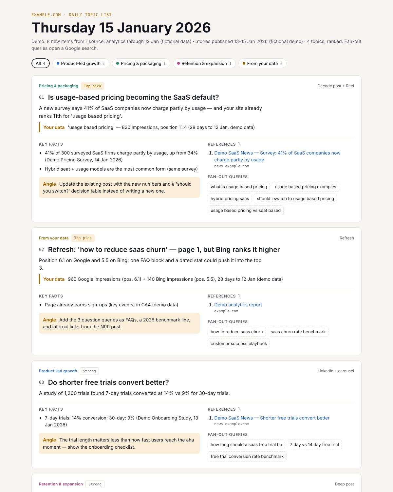

# Content Engine

**An open-source content operating system for one person or a small team: news in your niche + your own search data → ranked topics every morning → blog posts, LinkedIn posts, carousels and Reels written by Claude → a weekly SEO & AI-search audit that tells you what to fix.**

It runs on free GitHub Actions and Claude skills. Pick a niche preset (or define your own pillars), answer a few questions, and every script and skill adapts to you — in your language, on WordPress or a static site.

**👀 See the output before you set anything up: [examples/](examples/)** — a real-format digest, SEO audit, analytics report and topic list.



```
 Your sources (RSS / sitemaps) ──► News scanner ─────────────┐  daily, GitHub Actions
 Search Console + GA4 + Bing ───► Analytics report ──────────┤  daily, GitHub Actions
 Your website ──────────────────► SEO & AI-search audit ─────┤  weekly, GitHub Actions
                                                             ▼
                    Topic list (Claude task or Claude API workflow) ──► email to you
                                                             ▼
   Claude skills: blog post · decode post · LinkedIn · carousel · Reel · Medium · weekly plan · audit fixes
                                                             ▼
                     Your site first ──► LinkedIn · Instagram · Medium · newsletter
```

## What you get

| Feature | What it does | Needs |
|---|---|---|
| **News scanner** | Reads 50–80 sources (RSS or sitemap), opens each new article, pulls the summary, numbers and a quote, tags it by your pillars, ranks it, writes a daily digest | Nothing — works on day one |
| **Search analytics** | Pulls Google Search Console, GA4 and Bing Webmaster Tools daily and finds striking-distance queries, CTR fixes, pages to refresh, content gaps, question queries, cannibalisation, AI-assistant referrals and Bing-only demand | A free Google service account; a free Bing API key |
| **SEO & AI-search audit** | Weekly crawl, 60+ checks: broken links (internal and outbound), redirects, titles, metas, H1s, thin/duplicate content, canonicals, noindex, sitemap hygiene and freshness, orphan pages, hreflang, heavy and unsized images, link text, schema (incl. FAQ-vs-page), Open Graph, mixed content, HTTPS — **plus which AI crawlers (ChatGPT, Perplexity, Claude, Gemini) can read you**, llms.txt, optional JavaScript rendering and Core Web Vitals | Nothing (PageSpeed key, Playwright optional) |
| **Daily topic list** | 8–12 news topics + 2–4 "from your data" topics with facts, sources, angle and fan-out queries; rendered as markdown, an email and a web page | A Claude scheduled task **or** a Claude API key; SMTP for email |
| **15 Claude skills** | Blog posts (AEO + SEO), decode posts, LinkedIn posts & carousels, X threads, Reels/Shorts (script → video with Remotion), Medium articles, the newsletter, the blog cascade, pre-publish feedback, weekly planning, search analytics, SEO audit, AI-visibility tracking, topic list, and a setup interview | Claude (claude.ai or Claude Code) |
| **Publishing** | WordPress drafts through a connector, or Markdown + front matter for Next.js, Astro, Hugo, Jekyll and Eleventy (`tools/export_post.py`) | Optional |
| **Brand kit generator** | Avatar, wordmarks, OG image, LinkedIn/Facebook covers and a quote card from your colours | Pillow |
| **Optional integrations** | Notion Fuel Database, OpenSEO (backlinks, rankings, AI visibility), WordPress drafts, Canva, a social scheduler | Your own accounts |

**Niche presets:** AI in marketing & SEO · AI for business & AI security · B2B SaaS · E-commerce & DTC · Personal finance · Health & fitness · Travel · Local business · Developer tools · or start blank. The first two ship with 58–77 tested sources; the others ship 8–13 well-known starter sites whose feeds are found on the first run — add the sites you read the same way.

## Quick start (15 minutes to a working scanner and audit)

1. **Get your own copy.** Click **Use this template** (or Fork) → make it **private** if you'll store analytics data in it.
2. **Set it up for your niche.**
   ```bash
   git clone https://github.com/<you>/<your-repo> && cd <your-repo>
   python3 setup/init.py            # ~5 minutes of questions; or open the repo in Claude and say "set up the engine"
   pip install Pillow && python3 brand/scripts/make_brand.py
   git add -A && git commit -m "Set up for my niche" && git push
   ```
3. **Turn on Actions.** Repo → **Actions** → enable workflows → run **Daily fuel scan** and **Weekly SEO audit** once.
4. Read `scanner/sources/digests/` and `seo-audit/reports/latest.md`. 🎉

Windows: use `py` instead of `python3`, or Git Bash (see the setup guide). Then add Search Console, GA4 and Bing, email, and the topic list when you're ready: **[docs/SETUP.md](docs/SETUP.md)** walks through every step, and **[docs/ACCESS.md](docs/ACCESS.md)** lists every access and secret, what it's for, and whether you need it.

## Using it with Claude

Open the repo in **Claude Code**, or add it to a **claude.ai project** (or a Claude session with GitHub). Claude reads `CLAUDE.md` and the skills in `.claude/skills/`, which all read `engine.config.json`. Try:

- "Set up the engine for my niche" → `engine-setup`
- "Plan my week" → `weekly-plan`
- "What should I write today?" → `topic-list`, then `blog-post`
- "Turn this link into today's content" → `news-fast-lane`
- "Distribute this post" → `blog-cascade` · "Write the LinkedIn post" → `linkedin-posts` · "Make a reel" → `reel`
- "How is the site doing?" → `search-analytics` · "Audit my site" → `seo-audit` · "Are we cited in AI answers?" → `ai-visibility`
- "Review this draft" → `content-feedback` · "Write this week's newsletter" → `newsletter` · "Make it a thread" → `x-thread`

In claude.ai you can also upload a skill folder under **Customize → Skills**, so it's available outside the repo.

## Repo map

| Path | What's in it |
|---|---|
| `engine.config.json` | **Your settings** (written by `setup/init.py`; see `engine.config.example.json`) |
| `setup/` | `init.py` (setup), `presets/` (niches), `discover_feed.py` (add sources), `schedule.py` (local times → cron), `create_notion_db.py` |
| `scanner/` | `fuel_scanner.py` + `sources/` (sources.json, territories.json, digests, SOURCES.md health report) |
| `analytics/` | `fetch.py` (Search Console + GA4), `analyze.py` (report + opportunities.json), `reports/` |
| `seo-audit/` | `audit.py` (crawler), `issues.py` (every check, why it matters, how to fix), `reports/` |
| `tools/` | Topic-list builder (Claude API), renderer and email sender; static-site export |
| `.claude/skills/` | The 15 Claude skills |
| `.github/workflows/` | Daily analytics, scan, topic list (Claude API) and email; weekly audit; tests |
| `docs/` | Setup, access, updating, customising, integrations, production kit, launch checklist, daily cadence, content system, troubleshooting |
| `examples/` | Sample outputs and screenshots (from a fictional demo site) |
| `tests/` | End-to-end smoke test with a fixture site (`bash tests/run.sh`) |
| `brand/`, `content/`, `templates/`, `tracker/` | Brand kit, drafts and topic lists, copy-paste prompts, weekly numbers |

## Principles baked into the skills

- **Topic first, then write.** Claude proposes; you approve.
- **The anchor rule.** Every piece needs 2 of 3: a dated source, a moment from your work, an artifact (a test or your own number). No invented statistics, ever.
- **Your data beats a blank page.** Queries you already get impressions for come before new ideas.
- **Site first.** Your website is the canonical home; everything else points back to it.
- **Nothing is published, scheduled or sent without your go-ahead.**

## Credits and licence

MIT — see [LICENSE](LICENSE). Built by **[Mayank Ranjan](https://ranjanmayank.in)** ([LinkedIn](https://www.linkedin.com/in/ranjanmayank-mr/)) from the engines he runs for his own sites.
The SEO audit's issue set and thresholds are adapted from **[OpenSEO](https://github.com/every-app/open-seo)** (MIT). Fonts: Outfit and Geist Mono (SIL Open Font License). See [NOTICE.md](NOTICE.md).

**Updating your copy:** [docs/UPDATING.md](docs/UPDATING.md) · **What changed:** [CHANGELOG.md](CHANGELOG.md)

Contributions welcome — new niche presets and tested source lists especially. See [CONTRIBUTING.md](CONTRIBUTING.md), [SECURITY.md](SECURITY.md) and the [code of conduct](CODE_OF_CONDUCT.md).
