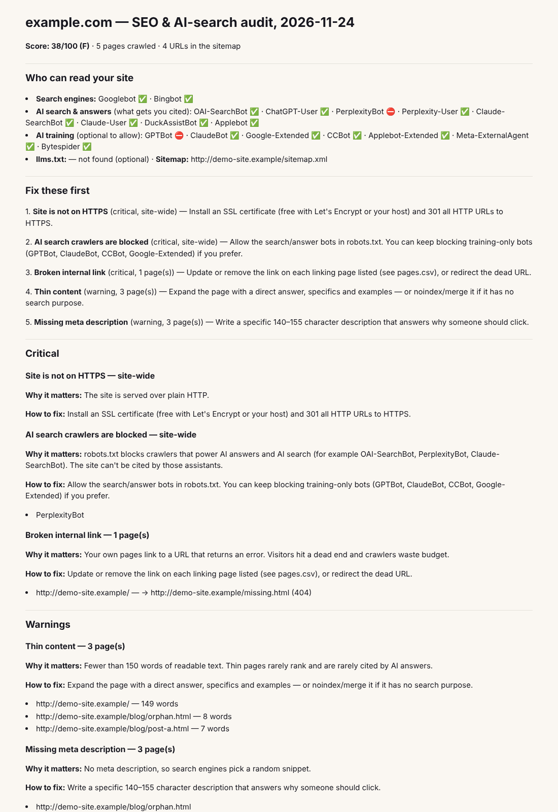

# Examples

What the engine produces, built from a **fictional demo site and fictional news** — none of these numbers, stories or sites are real. Rebuild them any time with `bash tests/build_examples.sh` (no network needed).

| File | Produced by | Screenshot |
|---|---|---|
| [`digest.md`](digest.md) | The daily news scanner — top picks tagged by pillar, each with a source card | [digest.png](screenshots/digest.png) |
| [`SOURCES.md`](SOURCES.md) | The scanner's source health report | — |
| [`seo-audit.md`](seo-audit.md) | The weekly SEO & AI-search audit of a deliberately broken demo site | [seo-audit.png](screenshots/seo-audit.png) |
| [`analytics-report.md`](analytics-report.md) | The daily Search Console + GA4 + Bing report (demo data) | [analytics-report.png](screenshots/analytics-report.png) |
| [`topic-list.md`](topic-list.md), [`topic-list.html`](topic-list.html), [`topic-list-email.html`](topic-list-email.html) | The daily topic list: markdown, web page and email | [topic-list.png](screenshots/topic-list.png), [topic-email.png](screenshots/topic-email.png) |

The demo config is `engine.config.example.json` (a B2B SaaS growth blog, preset `b2b-saas`).

